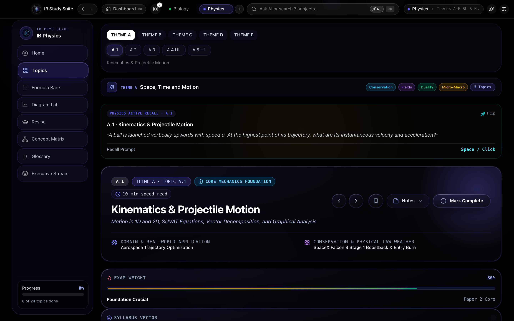
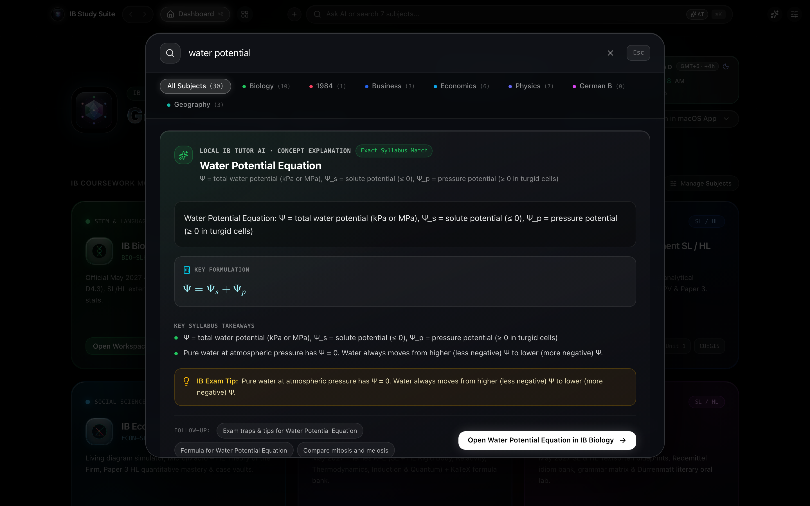

# IB Study Suite

An offline-first desktop study workspace for the IB Diploma Programme (May 2027 syllabi), built with Next.js, TypeScript, Tailwind CSS, and native desktop wrappers for macOS and Windows.


## Subjects Included

- **IB Biology (SL/HL)** — 4×4 Theme × Level-of-Organization matrix, 40 topics, executive stream, lab & case vault, and flashcards.
- **IB Physics (SL/HL)** — Themes A–E, formula bank, diagram lab, and timed exam sprint.
- **IB Economics (SL/HL)** — Units 1–4, interactive diagram studio, real-world case vault, and evaluation checklists.
- **IB Business Management (SL/HL)** — Units 1–5, BMT toolkit, CUEGIS sandbox, and case study notes.
- **IB Geography (SL/HL)** — Core & HL themes, case study vault, fieldwork & stats formulas, and glossary.
- **IB German B (SL/HL)** — Thematic dossiers, grammar lab, Textsorten templates, Redemittel, and TestDaF/oral prep.
- **English A Literature: *Nineteen Eighty-Four*** — Chapter-by-chapter analysis, quote bank, motif tracker, and essay planning.

## Features

- **Focused 3-Column Workspace** — Collapsible navigation sidebar, main study canvas, and an exam companion inspector (mark schemes, formulas, active recall cards, and persistent notes).
- **Executive Stream** — Scannable syllabus digest grouped by theme or unit so you can jump straight into any topic.
- **Local AI Search (`⌘K` / `Ctrl+K`)** — Instant offline search and synthesized answers with KaTeX math rendering across whichever subjects you have enabled.
- **Split View & Persistent Tabs** — Open multiple subjects side by side without losing scroll position or notes.
- **SL / HL & Subject Filtering** — Choose your exact IB subjects and SL/HL levels during onboarding or anytime from **Manage Subjects** (`SlidersHorizontal` in the top bar).

## Screenshots

| Executive Stream | Physics Workspace & Inspector |
| --- | --- |
|  |  |

| Universal Search (`⌘K`) | Onboarding Walkthrough |
| --- | --- |
|  |  |

## Download & Installation (v1.0.1)

Grab the latest native desktop installers directly from the [GitHub Releases](../../releases/latest) page:

- **🍎 macOS (Apple Silicon & Intel Universal):** [`IBStudySuite-macOS-v1.0.1.dmg`](https://github.com/ayaandev09/ib-study-suite/releases/download/v1.0.1/IBStudySuite-macOS-v1.0.1.dmg) or [`IBStudySuite-macOS-v1.0.1.zip`](https://github.com/ayaandev09/ib-study-suite/releases/download/v1.0.1/IBStudySuite-macOS-v1.0.1.zip)
- **🪟 Windows (x64):** [`IBStudySuite-Windows-x64-v1.0.1.exe`](https://github.com/ayaandev09/ib-study-suite/releases/download/v1.0.1/IBStudySuite-Windows-x64-v1.0.1.exe) or [`IBStudySuite-Windows-x64-v1.0.1.zip`](https://github.com/ayaandev09/ib-study-suite/releases/download/v1.0.1/IBStudySuite-Windows-x64-v1.0.1.zip)

### First-Time Opening & Security Permissions

Because IB Study Suite is an open-source, community-distributed academic tool without paid enterprise certificates, your operating system will show a standard first-time security prompt:

#### On macOS
1. Open the downloaded `.dmg` and drag **IB Study Suite** to your **Applications** folder.
2. **First launch:** Right-click (or Control-click) **IB Study Suite** in Applications and select **Open**.
3. In the alert asking if you want to open it, click **Open**.
4. *Alternative:* Go to **System Settings → Privacy & Security**, scroll down to the **Security** section, and click **"Open Anyway"**.
5. *Terminal fallback (if quarantine flag persists):*
   ```bash
   xattr -cr /Applications/IBStudySuite.app
   ```

#### On Windows
1. Double-click the downloaded setup installer (`.exe` or `.msi`).
2. When Windows SmartScreen displays the blue protection notice (*"Windows protected your PC"*):
   - Click **"More info"**
   - Click **"Run anyway"**
3. The app will install and open immediately with full offline capabilities.

## Development

```bash
npm install
npm run dev
```

Run tests and production static export:

```bash
npx tsc --noEmit
npm test
npm run build
```
