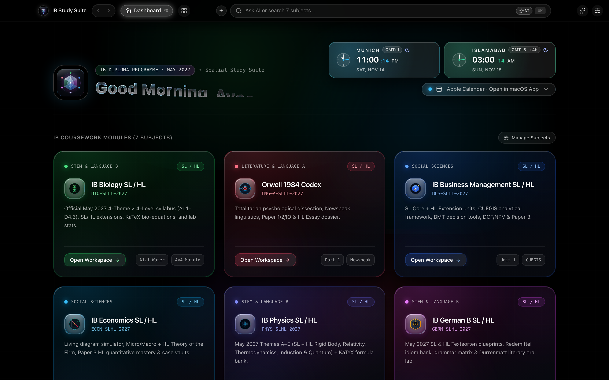
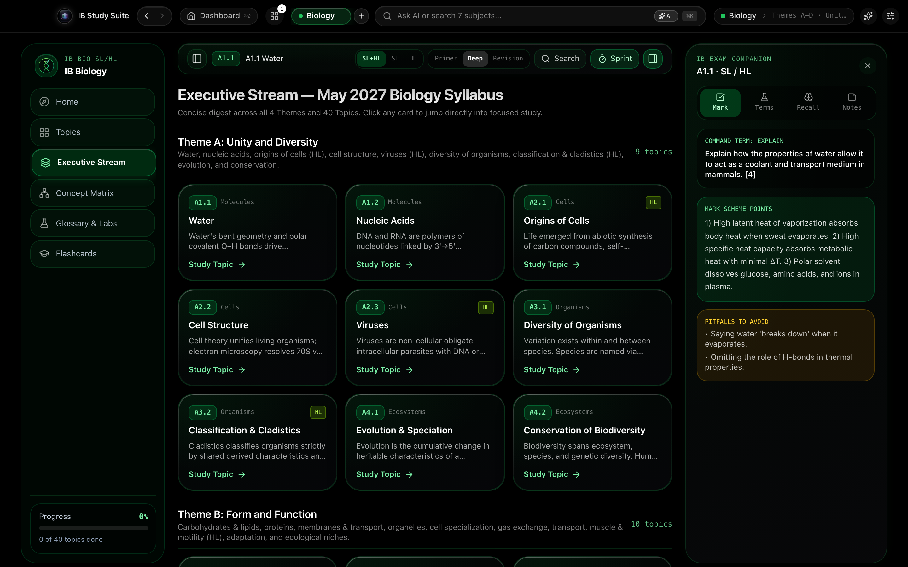
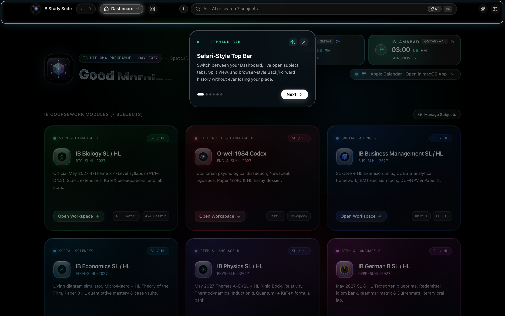

# IB Study Suite

An offline-first desktop study workspace for the IB Diploma Programme (May 2027 syllabi), built with Next.js, TypeScript, Tailwind CSS, and native desktop wrappers for macOS and Windows.



## Subjects Included

- **IB Biology (SL/HL)** — 4×4 Theme × Level-of-Organization matrix, 40 topics, executive stream, lab & case vault, and flashcards.
- **IB Physics (SL/HL)** — Themes A–E, formula bank, diagram lab, and timed exam sprint.
- **IB Economics (SL/HL)** — Units 1–4, interactive diagram studio, real-world case vault, and evaluation checklists.
- **IB Business Management (SL/HL)** — Units 1–5, BMT toolkit, CUEGIS sandbox, and case study notes.
- **IB Geography (SL/HL)** — Core & HL themes, case study vault, fieldwork & stats formulas, and glossary.
- **IB German B (SL/HL)** — Thematic dossiers, grammar lab, Textsorten templates, Redemittel, and TestDaF/oral prep.
- **English A Literature: *Nineteen Eighty-Four*** — Chapter-by-chapter analysis, quote bank, motif tracker, and essay planning.

## Features

- **Focused 3-Column Workspace** — Collapsible navigation sidebar, main study canvas, and an exam companion inspector (mark schemes, formulas, active recall cards, and persistent notes).
- **Executive Stream** — Scannable syllabus digest grouped by theme or unit so you can jump straight into any topic.
- **Local AI Search (`⌘K` / `Ctrl+K`)** — Instant offline search and synthesized answers with KaTeX math rendering across whichever subjects you have enabled.
- **Split View & Persistent Tabs** — Open multiple subjects side by side without losing scroll position or notes.
- **SL / HL & Subject Filtering** — Choose your exact IB subjects and SL/HL levels during onboarding or anytime from **Manage Subjects** (`SlidersHorizontal` in the top bar).

## Screenshots

| Executive Stream | Physics Workspace & Inspector |
| --- | --- |
|  |  |

| Universal Search (`⌘K`) | Onboarding Walkthrough |
| --- | --- |
|  |  |

## Download (v1.0.0)

Grab the latest installers from the [Releases](../../releases) page:

- **macOS (Apple Silicon / Universal):** `IBStudySuite-macOS-v1.0.dmg` — open the `.dmg` and drag **IBStudySuite** into Applications.
- **Windows (x64):** `IBStudySuite-Windows-x64.exe` — standalone executable powered by WebView2 (pre-installed on Windows 10/11).

## Development

```bash
npm install
npm run dev
```

Run tests and production static export:

```bash
npx tsc --noEmit
npm test
npm run build
```
